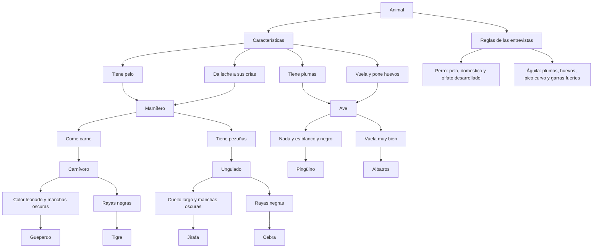

# Ontología para la identificación de animales

## 1. Objetivo

Organizar el conocimiento de la actividad de la bióloga Ana Torres y de las entrevistas realizadas por el equipo. Los hechos se representan en Python con un diccionario y las reglas con tuplas. A partir de las características registradas, el programa obtiene clasificaciones mediante inferencia.

## 2. ¿Qué representa esta ontología?

Una ontología organiza los conceptos de un tema y las relaciones que existen entre ellos. En este proyecto, el concepto principal es **animal**. Cada animal puede tener características, pertenecer a un grupo y cumplir las condiciones de una regla.

### Conceptos principales

- **Animal:** ser que se desea identificar.
- **Hecho:** información registrada, como que el perro tiene pelo.
- **Predicado:** característica o clasificación, por ejemplo `tiene_pelo` o `mamifero`.
- **Regla:** relación de condiciones y conclusión; se interpreta como “si se cumplen las condiciones, entonces se obtiene la conclusión”.
- **Inferencia:** proceso por el que se aplican reglas para obtener nuevas clasificaciones.

## 3. Gráfico de la ontología

El gráfico presenta los principales vínculos entre las características, los grupos y los animales. GitHub representa el bloque Mermaid como un diagrama cuando se visualiza este archivo.



## 4. Hechos representados en Python

En `main.py`, el diccionario `hechos` guarda predicados como claves y conjuntos de animales como valores.

Ejemplo:

```python
hechos = {
    "tiene_pelo": {"perro"},
    "tiene_plumas": {"aguila", "pinguino", "albatros"},
    "pico_curvo": {"aguila"}
}
```

Este ejemplo representa que el perro tiene pelo y que el águila, el pingüino y el albatros tienen plumas. En la implementación, cada predicado contiene los animales que cumplen la característica.

## 5. Reglas representadas con tuplas

Las reglas se almacenan como una tupla formada por las condiciones y una conclusión.

```python
(("tiene_pelo",), "mamifero")
(("tiene_plumas",), "ave")
(("ave", "nada", "blanco_negro"), "pinguino")
```

La primera regla significa que, si un animal tiene pelo, se clasifica como mamífero. La tercera requiere que se cumplan las tres condiciones: ser ave, nadar y tener color blanco y negro.

## 6. Reglas incluidas

1. Si un animal tiene pelo, es mamífero.
2. Si da leche a sus crías, es mamífero.
3. Si tiene plumas, es ave.
4. Si vuela y pone huevos, es ave.
5. Si es mamífero y come carne, es carnívoro.
6. Si es mamífero y tiene pezuñas, es ungulado.
7. Si es carnívoro, tiene color leonado y manchas oscuras, es guepardo.
8. Si es carnívoro y tiene rayas negras, es tigre.
9. Si es ungulado, tiene cuello largo y manchas oscuras, es jirafa.
10. Si es ungulado y tiene rayas negras, es cebra.
11. Si es ave, nada y tiene color blanco y negro, es pingüino.
12. Si es ave y vuela muy bien, es albatros.
13. La regla propuesta para el perro utiliza pelo, domesticación y olfato desarrollado.
14. La regla propuesta para el águila utiliza plumas, huevos, pico curvo y garras fuertes.

Las reglas son una representación simplificada para la práctica y no constituyen un método científico completo de identificación de especies.


## 7 Conclusión

Con esta representación aprendimos a organizar el conocimiento mediante hechos, predicados y reglas. El diccionario permite guardar las características de los animales, mientras que las tuplas representan las condiciones y conclusiones. El archivo Python utiliza estos datos para obtener clasificaciones y el diagrama de la ontología muestra de manera visual cómo se relacionan los conceptos.

